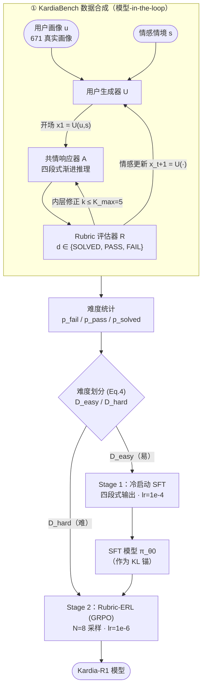
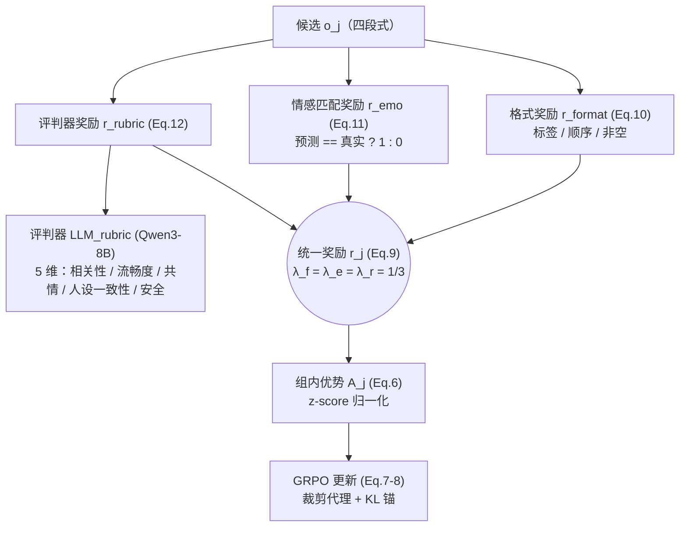
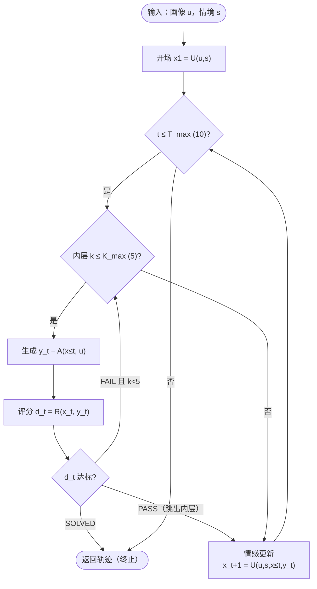

# Kardia-R1 模型结构示意图（Mermaid）

> 本文件用 Mermaid 绘制论文《Kardia-R1》的核心架构。在 VS Code 中安装
> **Markdown Preview Mermaid Support** 插件后即可预览，或直接粘贴到
> [mermaid.live](https://mermaid.live) / GitHub 渲染。

---

## 1. 整体架构：数据准备 + 两阶段训练

对应论文 Figure 2，覆盖「Rubric-Guided 数据合成 → 难度划分 → 冷启动 SFT → Rubric-ERL」全链路。

---

## 2. 四段式渐进推理（单轮生成结构）

共情被建模为「理解 → 推理 → 情感识别 → 回复」的换位思考过程。

---

## 3. Rubric-ERL 奖励组合（Eq. 9–12）

统一奖励 = 格式奖励 + 情感匹配奖励 + 评判器奖励（等权 λ = 1/3）。

---

## 4. 数据合成 Markov 过程（Algorithm 1）

---

## 5. 各模块在代码中的对应关系

| Mermaid 图 | 对应论文公式 | 代码位置 |
|---|---|---|
| 图 2 四段式 | Section 4 | `kardia/tags.py`、`kardia/data.py` |
| 图 3 奖励 | Eq. 9–12 | `kardia/rewards.py`、`kardia/judge.py` |
| 图 4 数据合成 | Algorithm 1 | `scripts/generate_data.py` |
| 难度划分 | Eq. 4 | `kardia/partition.py` |
| GRPO 更新 | Eq. 6–8 | `kardia/grpo.py` |
